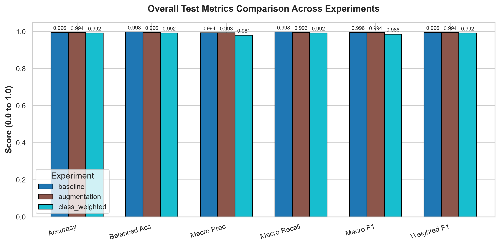
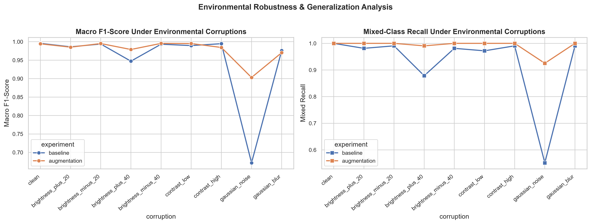
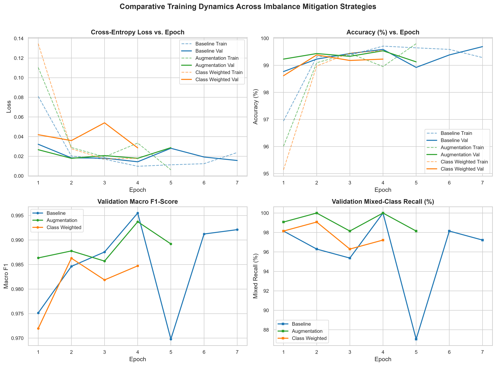

# Robust Deep Learning for Fruit Quality Classification

> A reproducible PyTorch study of postharvest fruit grading under class imbalance and environmental variation.

<p align="center">
  
</p>

<p align="center"><em>Clean-test metrics generated by this repository's experiment workflow.</em></p>

## Table of contents

- [Project overview](#project-overview)
- [Why this problem matters](#why-this-problem-matters)
- [Dataset and task](#dataset-and-task)
- [Methodology](#methodology)
- [Results and interpretation](#results-and-interpretation)
- [Repository architecture](#repository-architecture)
- [Installation and quick start](#installation-and-quick-start)
- [Running the workflow](#running-the-workflow)
- [Outputs](#outputs)
- [Reproducibility, limitations, and next steps](#reproducibility-limitations-and-next-steps)

## Project overview

This repository implements an end-to-end computer-vision workflow for **postharvest fruit-quality classification**. Given an RGB image of a fruit, the system assigns one of three quality labels:

| Label | Meaning |
| --- | --- |
| **Good** | Pristine, commercially acceptable fruit |
| **Bad** | Clearly decayed, damaged, or unmarketable fruit |
| **Mixed** | Fruit with minor blemishes, partial defects, or transitional ripening characteristics |

The central research question is not simply whether a model can score well on clean images. It is whether an imbalance-aware training strategy can preserve recognition of the underrepresented **Mixed** class when camera conditions become less ideal.

The project therefore compares three DenseNet121 transfer-learning experiments under identical splits and evaluation procedures:

1. **Baseline** — standard training with no imbalance intervention.
2. **Augmentation + sampling** — conservative transformations plus minority-aware weighted sampling.
3. **Class-weighted loss** — inverse-frequency weights in the loss function, with the natural training distribution retained.

Each trained model is evaluated on a clean held-out test set, then stress-tested using controlled brightness, contrast, blur, and sensor-noise perturbations. The workflow exports metrics, predictions, confusion matrices, training histories, and research-ready comparison figures.

## Why this problem matters

Automated optical sorting can reduce postharvest loss and make commercial grading more consistent. In real sorting lines, however, the difficult cases are rarely fruit that is perfectly pristine or obviously spoiled. The operationally important cases often have subtle surface marks, partial bruising, or uneven ripening—the **Mixed** category in this project.

Two practical challenges follow:

- **Class imbalance:** Mixed-quality fruit is much less common than Good fruit, so a model can appear accurate while underperforming on the class that needs the most careful treatment.
- **Image variation:** Lighting, camera noise, motion, lens blur, and contrast changes can alter visual cues that a clean-lab model relies upon.

This project treats robust minority-class performance as a first-class evaluation target rather than relying on accuracy alone.

## Dataset and task

The dataset contains **19,526 verified RGB images** across six fruit varieties: Apple, Banana, Guava, Lime/Lemon, Orange, and Pomegranate. The supplied dataset audit reports no unreadable images and no duplicate MD5 hashes.

### Split and class distribution

| Quality class | Train | Validation | Test | Total | Share |
| --- | ---: | ---: | ---: | ---: | ---: |
| Good | 9,331 | 1,166 | 1,167 | 11,664 | 59.73% |
| Bad | 5,430 | 679 | 679 | 6,788 | 34.76% |
| Mixed | 859 | 108 | 107 | 1,074 | 5.50% |
| **Total** | **15,620** | **1,953** | **1,953** | **19,526** | **100.00%** |

The training-set majority-to-minority ratio is **10.86:1** (Good to Mixed). This is why overall accuracy is reported alongside balanced accuracy, macro F1, and Mixed-class precision/recall/F1.

### Data safeguards

- The project uses pre-established stratified 80/10/10 train/validation/test splits.
- The validation and test sets are never oversampled or augmented.
- A versioned manifest, [`fruit_quality_dataset_manifest.csv`](fruit_quality_dataset_manifest.csv), makes assignments auditable.
- Run `python scripts/audit_dataset.py` to verify files, class counts, image modes, duplicates, and split integrity in your local copy.

> The raw dataset is not included in the repository. Place it in `Processed Images_Fruits/` or change `dataset.root_dir` in [`configs/config.yaml`](configs/config.yaml).

## Methodology

### Model architecture

The classifier is initialized from torchvision's ImageNet-pretrained **DenseNet121**. Dense connectivity encourages reuse of visual features and is well suited to fine-grained surface-pattern recognition.

| Component | Implementation |
| --- | --- |
| Backbone | ImageNet-pretrained DenseNet121 |
| Classifier | Global feature representation → dropout (0.2) → 3-class linear layer |
| Input size | 224 × 224 RGB |
| Optimizer | AdamW |
| Head / backbone learning rates | 1e-3 / 1e-4 |
| Weight decay | 1e-4 |
| Selection metric | Validation macro F1 |
| Early stopping | Patience of 2 epochs |
| Acceleration | Automatic mixed precision when CUDA is available |

The canonical values live in [`configs/config.yaml`](configs/config.yaml), so experiments can be reproduced or adjusted without changing source code.

### Three controlled experiments

| Experiment | Training treatment | What it tests |
| --- | --- | --- |
| `baseline` | Standard transforms and unweighted cross-entropy | Reference performance without imbalance mitigation |
| `augmentation` | Random resized crop, horizontal flip, rotation, color jitter, and `WeightedRandomSampler` with a 5× Mixed-class boost | Whether richer minority exposure improves invariance and recall |
| `class_weighted` | Natural sample frequency with inverse-frequency `CrossEntropyLoss` weights | Whether loss-level reweighting improves minority outcomes without resampling |

For the class-weighted experiment, the class weight for class *c* follows `N / (K × n_c)`, where `N` is the number of training samples, `K` is the number of classes, and `n_c` is the class count. The resulting Mixed-class weight is substantially larger because it is the rarest class.

### End-to-end workflow

```text
Dataset + manifest
        │
        ▼
Audit and split validation
        │
        ▼
Experiment-specific transforms / sampling / loss
        │
        ▼
DenseNet121 training and validation-Macro-F1 checkpointing
        │
        ├──────────────► Clean-test evaluation
        │                   ├─ metrics and confidence intervals
        │                   ├─ predictions and confusion matrices
        │                   └─ paired experiment comparisons
        ▼
Environmental perturbation benchmark
        │
        ▼
Reports, tables, and publication-ready plots
```

## Results and interpretation

### Clean-test results

All models were evaluated on the same untouched test set of 1,953 images.

| Experiment | Accuracy | Balanced accuracy | Macro F1 | Mixed precision | Mixed recall | Mixed F1 | Training time |
| --- | ---: | ---: | ---: | ---: | ---: | ---: | ---: |
| Baseline | **99.59%** | **99.77%** | **0.9956** | 0.9907 | **100.00%** | **0.9953** | 30.0 min |
| Augmentation + sampling | 99.44% | 99.58% | 0.9943 | 0.9907 | **100.00%** | **0.9953** | 20.1 min |
| Class-weighted loss | 99.23% | 99.23% | 0.9864 | 0.9550 | 99.07% | 0.9725 | **11.0 min** |

The clean test set shows a high performance ceiling: every approach achieves over 99% accuracy. Bootstrap confidence intervals and paired McNemar tests are included in the [full experiment report](outputs/reports/experiment_report.md); the clean-split differences were not statistically significant at the 0.05 level.

The practical lesson is that clean-set accuracy alone does not distinguish the methods very well. Robustness testing provides the stronger evidence.

### Robustness benchmark

To simulate common packhouse image degradations, each model is evaluated under brightness shifts, contrast shifts, Gaussian blur, and Gaussian noise. The table focuses on the most revealing condition: sensor-like Gaussian noise.

| Gaussian-noise result | Baseline | Augmentation + sampling | Class-weighted loss |
| --- | ---: | ---: | ---: |
| Accuracy | 74.71% | **90.73%** | 82.39% |
| Mixed recall | 58.88% | **91.59%** | 89.72% |
| Mixed F1 | 0.7412 | **0.9469** | 0.8727 |

<p align="center">
  
</p>

<p align="center"><em>Environmental stress testing reveals differences hidden by the clean-test ceiling.</em></p>

Under Gaussian noise, the baseline accuracy drops by **24.88 percentage points** from its clean-test value, while the augmentation-and-sampling experiment maintains substantially stronger overall and Mixed-class performance. This supports the conclusion that conservative minority-focused augmentation improves visual invariance, not merely sample balance.

### What the results mean

- The **baseline** is highly effective when images closely resemble the clean test distribution but is fragile under noise.
- **Class-weighted loss** is computationally efficient and improves robustness relative to baseline, but it trades some Mixed precision for recall by predicting the minority class more aggressively.
- **Augmentation + sampling** gives the best robustness profile in the committed results. It preserves high clean-test performance and is notably more resilient to corrupted inputs.

These results are specific to this dataset, split, model, configuration, and single-seed training run. They should not be interpreted as a general production guarantee without external validation.

### Visual evidence

<p align="center">
  
</p>

<p align="center"><em>Training histories are stored as JSON logs and rendered into comparison figures.</em></p>

For further inspection, see the normalized confusion matrices in [`outputs/confusion_matrices/`](outputs/confusion_matrices/) and the per-image prediction files in [`outputs/predictions/`](outputs/predictions/).

## Repository architecture

```text
.
├── configs/
│   └── config.yaml                    # Dataset, training, augmentation, and output settings
├── scripts/
│   ├── audit_dataset.py               # Integrity checks, class distribution, split audit
│   └── compare_results.py             # Consolidated metrics, tables, and comparison plots
├── src/
│   ├── dataset.py                     # Dataset and DataLoader construction
│   ├── transforms.py                  # Evaluation and augmentation transforms
│   ├── models.py                      # DenseNet121 setup and parameter groups
│   ├── train.py                       # Training loop, AMP, early stopping, checkpointing
│   ├── evaluate.py                    # Test evaluation and prediction export
│   ├── metrics.py                     # Metrics, bootstrap intervals, McNemar testing
│   ├── robustness.py                  # Controlled corruption benchmark
│   ├── visualization.py               # Plots and confusion-matrix rendering
│   └── utils.py                       # Configuration, seed, device, and I/O utilities
├── tests/                             # Unit tests for data, metrics, and model setup
├── outputs/                           # Generated reports, figures, logs, and predictions
├── main.py                            # Unified command-line entry point
├── requirements.txt                   # Python dependencies
└── fruit_quality_dataset_manifest.csv # Versioned dataset manifest
```

## Installation and quick start

### Requirements

- Python 3.10–3.12
- NVIDIA GPU with CUDA recommended for training; CPU execution is supported but slower
- The local image dataset placed in `Processed Images_Fruits/`

### Create a virtual environment

```powershell
python -m venv .venv
.\.venv\Scripts\Activate.ps1
python -m pip install --upgrade pip
pip install -r requirements.txt
```

If you use an NVIDIA GPU, install the PyTorch build appropriate for your CUDA version before—or in place of—the generic PyTorch dependency. Use the official PyTorch installation selector to obtain the correct command for your environment.

### Validate the setup

```powershell
# Run the unit tests
python -m pytest -v tests

# Confirm the dataset structure and manifest integrity
python scripts/audit_dataset.py
```

## Running the workflow

### Run all experiments

This is the standard reproducible workflow: audit the dataset, train or reuse checkpoints, evaluate, run perturbation tests, and create reports.

```powershell
python main.py --experiment all
```

### Run a single experiment

```powershell
python main.py --experiment baseline
python main.py --experiment augmentation
python main.py --experiment class_weighted
```

### Common execution modes

| Goal | Command |
| --- | --- |
| Check the dataset only | `python main.py --audit-only` |
| Evaluate saved checkpoints without training | `python main.py --evaluate-only` |
| Skip perturbation testing | `python main.py --experiment all --skip-robustness` |
| Force a fresh baseline training run | `python main.py --experiment baseline --no-resume` |
| Override experiment settings | `python main.py --experiment augmentation --epochs 10 --batch-size 32 --seed 7` |

## Outputs

Every workflow stage writes inspectable artifacts rather than only printing a final score.

| Artifact | Location | Description |
| --- | --- | --- |
| Dataset audit | [`outputs/dataset_audit/`](outputs/dataset_audit/) | Class counts, distribution plot, and dataset summary |
| Checkpoints | `outputs/checkpoints/` | Best model weights by validation macro F1; intentionally Git-ignored |
| Training histories | [`outputs/logs/`](outputs/logs/) | JSON epoch histories for each experiment |
| Test predictions | [`outputs/predictions/`](outputs/predictions/) | Per-image predicted labels and confidence data |
| Metrics | [`outputs/reports/experiment_comparison.csv`](outputs/reports/experiment_comparison.csv) | Clean-test performance, timing, and selected epoch |
| Robustness data | [`outputs/reports/robustness_results.csv`](outputs/reports/robustness_results.csv) | Metrics under each controlled corruption |
| Research narrative | [`outputs/reports/experiment_report.md`](outputs/reports/experiment_report.md) | Detailed analysis, confidence intervals, and comparisons |
| Limitations | [`outputs/reports/limitations_and_future_work.md`](outputs/reports/limitations_and_future_work.md) | Scope, threats to validity, and future research directions |
| Figures | [`outputs/plots/`](outputs/plots/) and [`outputs/confusion_matrices/`](outputs/confusion_matrices/) | Curves, comparisons, analysis plots, and normalized matrices |

## Reproducibility, limitations, and next steps

### Reproducibility

- The default random seed is `42` and may be overridden with `--seed`.
- Hyperparameters and paths are centralized in [`configs/config.yaml`](configs/config.yaml).
- Checkpoint selection is based on **validation macro F1**, never test-set performance.
- Raw images, virtual environments, generated checkpoints, and large model files are excluded from Git to keep the repository lightweight.

### Limitations

- The Mixed class has only 107 test examples, so estimates for rare edge cases remain uncertain despite bootstrap intervals.
- Images are mostly captured in relatively controlled conditions; synthetic corruptions are informative but do not replace field validation in operating packhouses.
- Results use a single train/validation seed. Repeated multi-seed experiments would better quantify variance.
- RGB images cannot reveal internal defects such as core rot or internal browning.

### Recommended next steps

1. Evaluate on multi-site, seasonal, and production-line imagery.
2. Repeat experiments across multiple seeds and report aggregate uncertainty.
3. Add calibration and out-of-distribution detection before deployment.
4. Explore self-supervised agricultural pretraining and RGB + NIR/hyperspectral sensing.
5. Export and benchmark optimized models with ONNX Runtime, TensorRT, pruning, or quantization for edge hardware.

## License and data use

No license is currently declared for this repository. Before reusing the code, dataset, figures, reports, or model outputs, verify the permissions for the underlying data and add an appropriate license.
